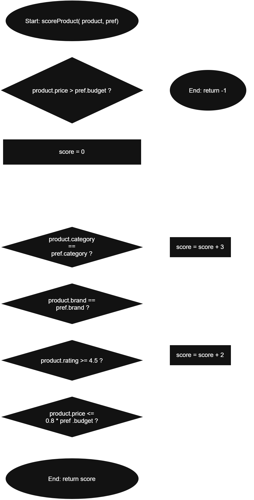

# T02 — scoreProduct(product, pref)

Input: `product` (Product), `pref` (Preference).  
Output: integer `score` (`-1` if `product.price > pref.budget`, otherwise `0` to `10`).



## Pseudocode

```text
FUNCTION scoreProduct(product, pref)
    IF product.price > pref.budget THEN
        RETURN -1
    END IF

    score = 0

    IF product.category == pref.category THEN
        score = score + 3
    END IF

    IF product.brand == pref.brand THEN
        score = score + 3
    END IF

    IF product.rating >= 4.5 THEN
        score = score + 2
    END IF

    IF product.price <= 0.8 * pref.budget THEN
        score = score + 2
    END IF

    RETURN score
END FUNCTION
