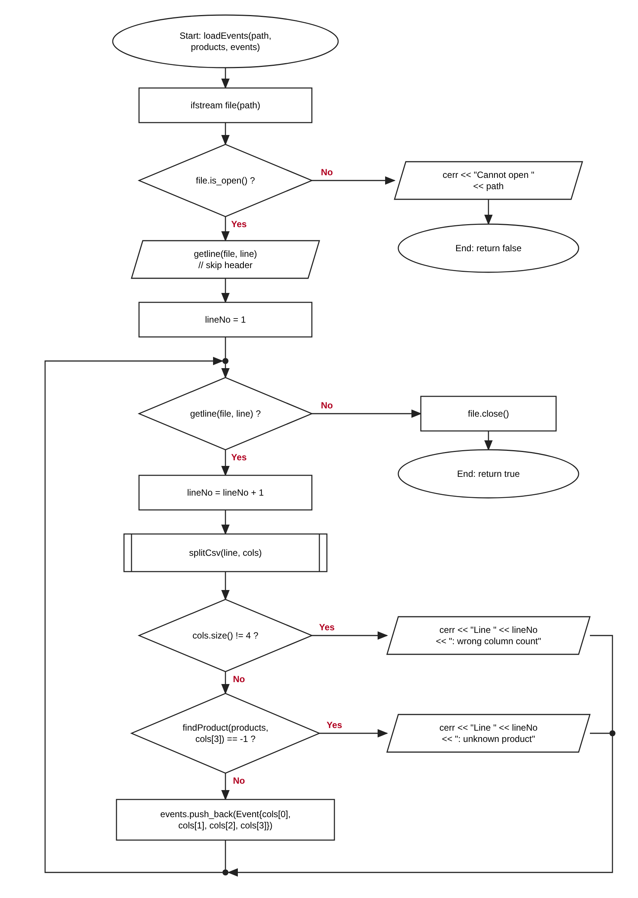
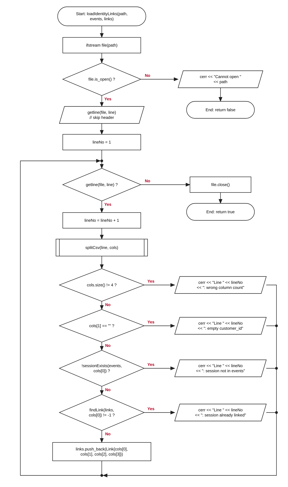
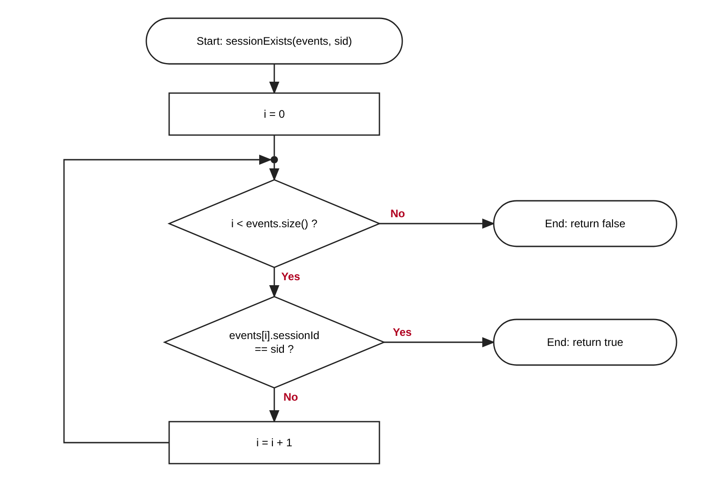
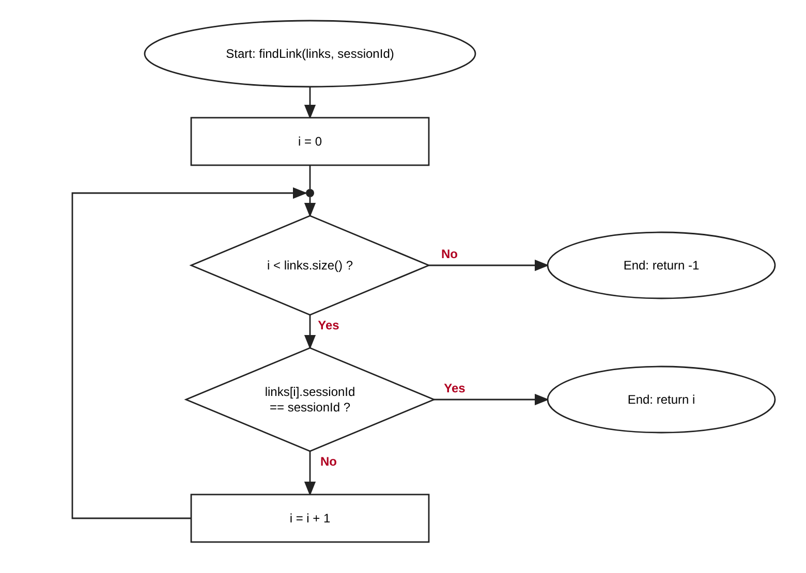

# T04 – loadEvents(), loadIdentityLinks(), sessionExists(), findLink()

## loadEvents(path, products, events)
Input: path to customer_events.csv, products (already loaded, sorted by product_id).
Output: events filled; return true if file opened, false otherwise.

Pseudocode:

    OPEN file(path)
    IF NOT file.is_open() THEN
        PRINT error to cerr; RETURN false
    READ header line (skip)
    lineNo = 1
    WHILE getline(file, line)
        lineNo = lineNo + 1
        splitCsv(line, cols)
        IF cols.size() != 4 THEN PRINT warning (lineNo) to cerr
        ELSE IF findProduct(products, cols[3]) == -1 THEN PRINT warning (lineNo) to cerr
        ELSE events.push_back(Event{cols[0], cols[1], cols[2], cols[3]})
    CLOSE file
    RETURN true

## loadIdentityLinks(path, events, links)
Input: path to identity_links.csv, events (already loaded).
Output: links filled (first link kept on conflict); return true/false.

Pseudocode:

    OPEN file(path)
    IF NOT file.is_open() THEN
        PRINT error to cerr; RETURN false
    READ header line (skip)
    lineNo = 1
    WHILE getline(file, line)
        lineNo = lineNo + 1
        splitCsv(line, cols)
        IF cols.size() != 4 THEN PRINT warning "wrong column count"
        ELSE IF cols[1] == "" THEN PRINT warning "empty customer_id"
        ELSE IF NOT sessionExists(events, cols[0]) THEN PRINT warning "session not in events"
        ELSE IF findLink(links, cols[0]) != -1 THEN PRINT warning "session already linked"
        ELSE links.push_back(Link{cols[0], cols[1], cols[2], cols[3]})
    CLOSE file
    RETURN true

## sessionExists(events, sid)
Output: true if some event has sessionId == sid.

    FOR i = 0 TO events.size() - 1
        IF events[i].sessionId == sid THEN RETURN true
    RETURN false

## findLink(links, sessionId)
Output: index of the link for this session, or -1 if the session is not linked.
Used by loadIdentityLinks (keep the first link) and later by T02/T05.

    FOR i = 0 TO links.size() - 1
        IF links[i].sessionId == sessionId THEN RETURN i
    RETURN -1
