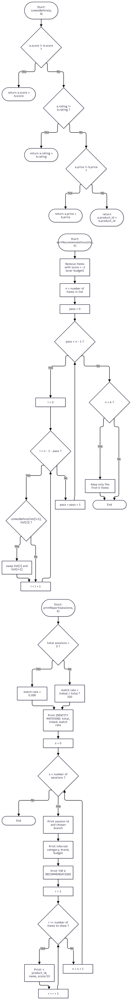

# T06: Sort Top-K and print report

Functions: `comesBefore()`, `sortRecommendations()`, `printReport()`
Assignee: Hoang | Reviewer: Khanh

Flowchart: `T06-sort-recommendations.drawio.png` (three diagrams from top to bottom: `comesBefore`, `sortRecommendations`, `printReport`)



## Requirement in the brief

P3 Section 4: score, then sort by score descending -> rating descending -> price ascending -> product_id ascending, and take the first K products.
P3 Section 5: write your own bubble sort or selection sort for Top-K, no `std::sort`.

## Assumptions

- A product with score = -1 is over budget (marker from `scoreProduct`, T02) and is not recommended.
- Products have unique `product_id`, so `comesBefore` never returns "equal".

## 1. comesBefore(a, b)

Returns true when recommendation `a` must be placed before recommendation `b`.

```
function comesBefore(a, b):
    if a.score != b.score:
        return a.score > b.score          # higher score first
    if a.rating != b.rating:
        return a.rating > b.rating        # higher rating first
    if a.price != b.price:
        return a.price < b.price          # lower price first
    return a.product_id < b.product_id    # smaller product_id first
```

## 2. sortRecommendations(list, K)

Bubble sort (own implementation) using `comesBefore`, then keep the first K items.

```
function sortRecommendations(list, K):
    remove every item with score = -1 from list
    n = number of items in list
    for pass = 0 to n - 2:
        for i = 0 to n - 2 - pass:
            if comesBefore(list[i + 1], list[i]):
                swap list[i] and list[i + 1]
    if n > K:
        keep only the first K items of list
```

## 3. printReport(sessions, K)

```
function printReport(sessions, K):
    if total sessions = 0:
        matchRate = 0.00
    else:
        matchRate = linked sessions / total sessions * 100
    print IDENTITY MATCHING: total sessions, linked sessions, matchRate
    for each session s:
        print session id and the chosen branch (a), (b) or (c)
        print inferred category, brand and budget
        print "TOP K RECOMMENDATIONS"
        for r = 1 to number of items to show:
            print r, product_id, name, score/10
```
