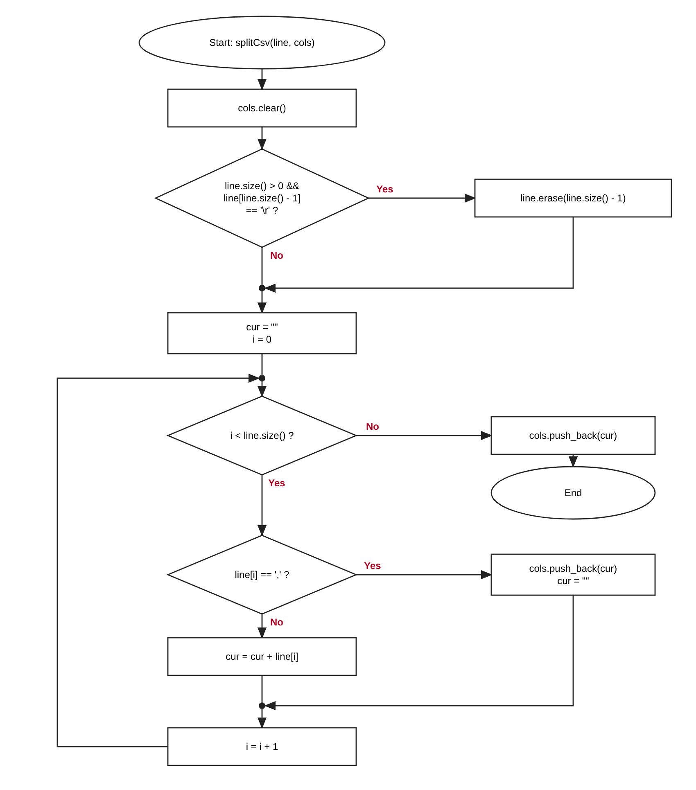
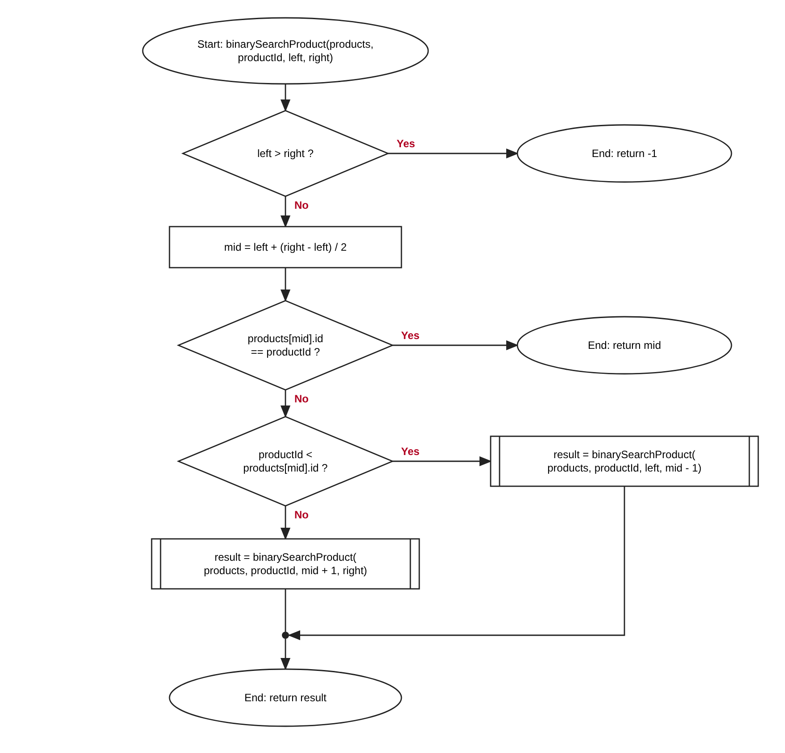
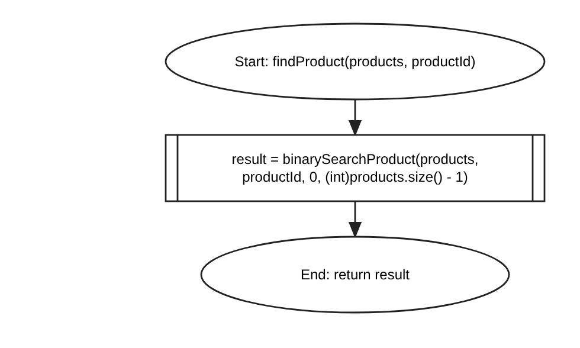

# T11 – Shared structs + helpers: splitCsv(), binarySearchProduct(), findProduct()

All record types the team agreed on are defined once here (Product, Event, Link, Transaction,
Preference, Recommendation). splitCsv is used by every CSV reader (T03, T04); findProduct by
T03, T04 and T05.

## splitCsv(line, cols)
Input: one CSV line. Output: cols = the fields split by ','. A trailing '\r' (Windows line ending) is removed.

    cols.clear()
    IF line ends with '\r' THEN remove it
    cur = ""
    FOR i = 0 TO line.size() - 1
        IF line[i] == ',' THEN
            cols.push_back(cur); cur = ""
        ELSE
            cur = cur + line[i]
    cols.push_back(cur)

## binarySearchProduct(products, productId, left, right)  – recursive
Precondition: products sorted by id ascending (loadProducts, T03).
Output: index of the product with this id, or -1.

    IF left > right THEN RETURN -1                         // base case
    mid = left + (right - left) / 2                         // same formula as Session 6
    IF products[mid].id == productId THEN RETURN mid
    IF productId < products[mid].id THEN
        result = binarySearchProduct(products, productId, left, mid - 1)     // left half
    ELSE
        result = binarySearchProduct(products, productId, mid + 1, right)    // right half
    RETURN result

## findProduct(products, productId)

    result = binarySearchProduct(products, productId, 0, products.size() - 1)
    RETURN result

## Tests (run locally)
splitCsv("P001,Nike Pegasus 41,Running Shoes,Nike,3590000,4.7\r") -> 6 fields, last = "4.7"
splitCsv("ANON-8822,,10:30,x") -> 4 fields, field 1 = ""
findProduct on P001..P008: P001 -> 0, P008 -> 7, P005 -> 4, P999 -> -1, empty list -> -1
